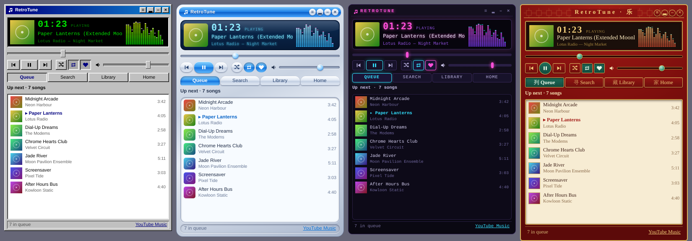

# RetroTune

A skinnable retro music player for macOS that plays YouTube Music. The real
YouTube Music page runs hidden inside the app; you only see the retro player.



- **Skins:** Classic Windows, Y2K Chrome, Night, Red Lacquer (Chinese). Add your own, see
  [`src/renderer/themes/README.md`](src/renderer/themes/README.md).
- **Menu bar:** current song scrolling in the top bar, click for a mini player,
  right-click for controls, skins and settings.
- **Browse without the Google UI:** queue, search (with filters), your library
  (playlists, liked songs, albums, artists, history) and home recommendations.
- **Visualizer:** spectrum bars or oscilloscope (click it to switch), coloured per skin.
- **Compact mode**, always on top, menu-bar-only mode, song-change notifications.
- Keyboard media keys and the macOS Now Playing widget work through the embedded player.

## Run it

Needs [Node.js](https://nodejs.org) 20 or newer.

```
npm install
npm start
```

First launch: click **Sign in** (bottom right) and sign in to Google in the
window that opens, then close that window. The session is remembered.

To build a normal app you can drag into Applications:

```
npm run dist        # creates dist/RetroTune-<version>.dmg
```

The build is not notarised by Apple, so the first time right-click the app and choose Open.

## Using it

| | |
|---|---|
| Double-click a row (or Return) | play the song / open the album, artist or playlist |
| Space | play / pause |
| Cmd+F | search |
| Cmd+← / Cmd+→ | previous / next |
| Cmd+L | like |
| Cmd+Y | show the real YouTube Music window |
| ≡ button or right-click | menu: skins, visualizer, compact mode, settings |
| Click the time | elapsed / remaining |

## How it works

```
src/main/main.js      windows, menu bar item, settings, message routing
src/ytm/agent.js      injected into music.youtube.com: reads the player, runs commands
src/ytm/parse.js      turns YouTube Music's data responses into simple lists
src/renderer/         the retro UI (base.css + one folder per skin)
```

YouTube Music has no public playback API, so this drives the web page. If
Google changes the page, controls or lists can break; the selectors live in
`src/ytm/agent.js` and the response parsing in `src/ytm/parse.js`
(`npm test` checks the parser against saved responses in `fixtures/`).

Known limits: playlists show their first 100 songs; free accounts still get
ads (shown as "Advertisement"); "Shuffle" reshuffles the current queue.
